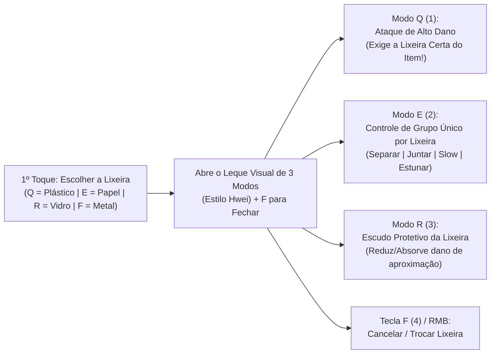

# Planejamento de Design & Mecânicas 2.0: Combos *Devil May Cry* + Comandos *Hwei (LoL)* + Inimigos Recicláveis

> **Registro da Visão do Autor (Matheus Maia Rangel):**
> Este documento consolida e estrutura a evolução central do sistema de combate, controles e combos do **EcoCombo 3D**, priorizando a tomada de decisão tática do jogador antes da construção do menu principal.

---

## 1. Diagnóstico: Por que Evoluir o Sistema de Combos e Comandos?

No protótipo inicial (MVP), o jogador combinava quaisquer 2 cores para disparar um projétil contra "bichos" genéricos da poluição. Embora funcional, isso gerava um problema de *game design*:
* **Falta de decisão contextual ("Apertar qualquer coisa"):** O jogador podia alternar receitas aleatoriamente (ex.: `Q+E`, depois `R+F`, depois `Q+R`) sem precisar observar quem era o inimigo ou qual era a situação da arena. Todo ataque era forte e o multiplicador nunca parava.
* **Objetivo da Nova Mecânica:** Fazer o jogador **pensar no que usar e em qual momento**, conectando diretamente:
  1. **Quem é o inimigo que está vindo?** (O inimigo agora é um **Item Reciclável** específico: Garrafa PET, Porca de Metal, Caixa de Papelão, Garrafa de Vidro);
  2. **Qual Lixeira abrir?** (As 4 teclas `Q`, `E`, `R`, `F` representam as **4 Lixeiras CONAMA**);
  3. **Qual Modo Tático escolher no Leque?** (Inspirado no campeão **Hwei**, de *League of Legends*: Dano, Controle de Grupo/Juntar/Expandir, Stun ou Escudo Protetivo);
  4. **Como manter o Estilo no topo?** (Inspirado em **Devil May Cry**: Ranks **D, C, B, A, S, SS, SSS** com o **Multiplicador em grande destaque logo abaixo**).

---

## 2. Os Três Pilares da Nova Gameplay

### Pilar 1: Inimigos são os Próprios Itens Recicláveis ("Resíduos Vivos")

Em vez de monstros genéricos sem elemento definido, cada inimigo que surge na arena é um **Item Reciclável real** pertencente a uma das **4 cores/lixeiras CONAMA** atuais do jogo:

| Tecla da Lixeira | Cor CONAMA | Categoria da Lixeira | Exemplos de Inimigos-Itens na Arena | Comportamento / Ameaça na Arena |
| :---: | :--- | :--- | :--- | :--- |
| **`Q`** (ou `1`) | **Vermelho** (`#FF3B30`) | **Lixeira de Plástico** | **Garrafa PET**, Copo Descartável, Galão Plástico | Rápidos e elásticos; avançam em zigue-zague ou saltos curtos para encostar no jogador. |
| **`E`** (ou `2`) | **Azul** (`#007AFF`) | **Lixeira de Papel** | **Caixa de Papelão**, Pilha de Jornal, Cartolina | Vêm em maior quantidade (enxame leve) tentando cercar o protagonista. |
| **`R`** (ou `3`) | **Verde** (`#34C759`) | **Lixeira de Vidro** | **Garrafa de Vidro**, Pote de Conserva, Frasco Trincado | Perigosos e cortantes; causam alto dano de contato se chegarem perto sem escudo. |
| **`F`** (ou `4`) | **Amarelo** (`#FFCC00`) | **Lixeira de Metal** | **Porca de Metal**, Lata de Alumínio, Engrenagem | Pesados e resistentes (mais vida/blindagem); avançam firme em linha reta. |

#### Regra de Afinidade da Coleta Seletiva (Acerto vs. Erro de Lixeira)
* **Lixeira Correta (Ex.: Garrafa PET $\rightarrow$ Lixeira Vermelha/Plástico `Q`):**
  * Ocorre a **Reciclagem Eficiente**: o ataque aplica $100\%$ do efeito do modo escolhido + bônus do multiplicador, faz o **Rank Devil May Cry subir** (`D` $\rightarrow$ `SSS`) e aumenta o multiplicador embaixo!
* **Lixeira Incorreta (Ex.: Garrafa PET $\rightarrow$ Lixeira Amarela/Metal `F`):**
  * Ocorre **Descarte Incorreto / Contaminação**: o ataque causa dano mínimo ($20\%$), exibe o aviso `"LIXEIRA ERRADA! GARRAFA PET = PLÁSTICO (Q)"` e **derruba o Rank / Multiplicador**!

---

### Pilar 2: Comandos em 2 Etapas Estilo *Hwei* (*League of Legends*) — Lixeira + Leque de Modos

Inspirado no sistema de *Spellbook* (Grimório de Pincéis) do **Hwei** do *League of Legends*, cada comando é feito em **2 passos rápidos**:



#### Passo 1: Apertar a Tecla da Lixeira (`Q`, `E`, `R` ou `F`)
* Ao ver uma **Garrafa PET** se aproximando, o jogador aperta **`Q` (Lixeira de Plástico — Vermelha)**.
* Imediatamente abre um **Leque Visual de 3 Opções (`Q`, `E`, `R`)** na cor daquela lixeira (com **`F`** para fechar/cancelar).

#### Passo 2: Escolher um dos 3 Modos no Leque (`Q`, `E`, `R`)
Dentro da Lixeira aberta, cada uma das 3 teclas cumpre um papel tático claro — sendo que a tecla **`E` (Controle de Grupo)** muda de efeito dependendo de qual Lixeira você abriu:

| Tecla no Leque | Papel do Modo | Como Funciona |
| :---: | :--- | :--- |
| **`Q`** (`1`) | **Modo 1: Mais Dano (Destruição Seletiva)** | Disparo focado de alto dano. **Exige a Lixeira Correta do item atingido** (ex.: Lixeira de Plástico contra Garrafa PET) para causar dano máximo e subir o Rank DMC. |
| **`E`** (`2`) | **Modo 2: Controle de Grupo (Especial da Lixeira)** | Cada lixeira possui um controle de grupo próprio na tecla `E`:<br>• **Plástico (`Q` $\rightarrow$ `E`): SEPARAR** (Onda elástica que empurra/afasta itens próximos)<br>• **Papel (`E` $\rightarrow$ `E`): JUNTAR** (Vórtice de origami que puxa/agrupa itens num ponto)<br>• **Vidro (`R` $\rightarrow$ `E`): DESACELERAR / FRAGILIZAR** (Campo de cacos/prisma que aplica *Slow* de 70% e +25% de dano recebido)<br>• **Metal (`F` $\rightarrow$ `E`): ESTUNAR** (Pulso eletromagnético pesado que paralisa/*stun* os itens no lugar) |
| **`R`** (`3`) | **Modo 3: Protetivo (Escudo Seletivo)** | Cria um **Escudo da cor da Lixeira** ao redor do protagonista. Se o item correspondente àquela lixeira tentar encostar em você, **você recebe muito menos dano (ou zero dano)**, repele o item e mantém o multiplicador intacto! |
| **`F`** (`4`) | **Cancelar / Trocar Lixeira** | Fecha o leque atual imediatamente sem gastar disparo, permitindo abrir outra lixeira. |

---

### Pilar 3: Medidor de Combo Estilo *Devil May Cry* (`D` a `SSS`) + Multiplicador Destacado Embaixo

Para dar a sensação de ação frenética e estilosa de *Devil May Cry*, o HUD exibe um **Style Meter (Medidor de Estilo)** com duas partes integradas e super visíveis:

```
┌──────────────────────────────────────┐
│           RANK DE ESTILO             │
│                                      │
│               [ S ]                  │  <-- Letra Gigante Estilo DMC (D, C, B, A, S, SS, SSS)
│          SUSTENTÁVEL!                │  <-- Título estilizado do Rank + Barra de Tempo/Combo
│  ══════════════════════════════░░░░  │
│                                      │
│            ⚡ 4.0x ⚡                 │  <-- MULTIPLICADOR GIGANTE EMBAIXO (Bem destacado!)
│     + DANO  •  + PONTOS  •  + COMBO  │
└──────────────────────────────────────┘
```

#### Escala de Ranks e Multiplicadores em Destaque Abaixo

| Letra do Rank (DMC) | Nome Temático no EcoCombo | Multiplicador Destacado Embaixo | Cor e Feedback Visual | Como Alcançar / Subir |
| :---: | :--- | :---: | :--- | :--- |
| **`D`** | **Descartado** (*Dull*) | **`1.0x`** | Cinza / Opaco | Estado inicial ou após errar lixeira / repetir o mesmo ataque sem parar |
| **`C`** | **Coletor** (*Cool*) | **`1.5x`** | Azul Claro | Primeiros acertos com a lixeira correta |
| **`B`** | **Brigada Verde** (*Bravo*) | **`2.0x`** | Verde Vibrante | Sequência de acertos corretos sem errar a cor do item |
| **`A`** | **Alquimista** (*Awesome*) | **`3.0x`** | Amarelo Ouro | Alternando modos do leque (ex.: Juntar $\rightarrow$ Dano, ou Stun $\rightarrow$ Dano) |
| **`S`** | **Sustentável!** (*Stylish!*) | **`4.0x`** | Laranja / Vermelho Neon | Combos táticos fluidos entre lixeiras corretas e modos variados |
| **`SS`** | **Super Seletivo!!** (*Showtime!!*) | **`5.0x`** | Roxo / Magenta Elétrico | Alta precisão, múltiplos itens reciclados em combo e uso inteligente de controle/escudo |
| **`SSS`** | **Supremo Guardião Eco!!!** (*Smokin' Sexy Style!*) | **`6.0x`** | Ciano / Dourado Arco-Íris Pulsante | Domínio total da arena sem errar lixeira e variando os modos táticos |

#### Como o Estilo e o Multiplicador Funcionam na Prática:
1. **Subindo o Rank e o Multiplicador:**
   * Acertar um item com a **Lixeira Correta** soma pontos de estilo.
   * **Combinar modos diferentes** da lixeira (ex.: usar *Controle de Grupo* para juntar 3 Garrafas PET $\rightarrow$ usar *Stun* para travar $\rightarrow$ finalizar com *Mais Dano*, ou bloquear uma investida com *Escudo* e contra-atacar) dá **bônus dobrado de Estilo**, fazendo o Rank saltar rápido de `D -> C -> B -> A -> S -> SS -> SSS`!
2. **O que faz o Rank / Multiplicador cair:**
   * **Usar a Lixeira Errada** no item (ex.: usar Papel contra uma Porca de Metal) penaliza o estilo.
   * **Spammar sempre o mesmo modo sem pensar** (apertar só o ataque básico repetidamente) dá cada vez menos estilo (*Stale Move*), impedindo de subir para `S/SS/SSS`.
   * **Sofrer dano direto sem estar protegido pelo Escudo da cor certa** derruba o Rank.

---

## 3. Exemplo Prático de Jogabilidade (Cena Real na Arena)

Imagine o seguinte momento na partida:
1. **Na borda direita** surgem **3 Garrafas PET** (Plástico — Vermelho) correndo juntas.
2. **Na borda esquerda**, uma **Porca de Metal** (Metal — Amarelo) já está muito perto do protagonista, prestes a bater nele!
3. **O que o jogador pensa e faz em segundos:**
   * **1º Movimento (Defesa Rápida contra a Porca de Metal):**
     * Aperta **`F`** (Lixeira Amarela — Metal) $\rightarrow$ abre o leque amarelo $\rightarrow$ aperta **`F` (Modo Escudo)**.
     * O Escudo de Metal amarelo envolve o jogador! A Porca de Metal bate no escudo, causa **dano reduzido/zero** ao jogador e é empurrada para trás atordoada! O Rank sobe para **`B (2.0x)`**!
   * **2º Movimento (Controle de Grupo nas Garrafas PET):**
     * Aperta **`Q`** (Lixeira Vermelha — Plástico) $\rightarrow$ abre o leque vermelho $\rightarrow$ aperta **`E` (Modo Juntar/Controle de Grupo)** e clica nas 3 Garrafas PET.
     * Um vórtice vermelho puxa as 3 Garrafas PET para o mesmo ponto! O Rank sobe para **`A (3.0x)`**!
   * **3º Movimento (Finalização Explosiva):**
     * Aperta **`Q`** (Lixeira Vermelha — Plástico) $\rightarrow$ aperta **`Q` (Modo Mais Dano)** e dispara no grupo de Garrafas PET juntas!
     * Com o multiplicador em **`4.0x` (Rank `S — SUSTENTÁVEL!`)**, as 3 Garrafas PET são recicladas de uma vez em uma explosão neon!

---

## 4. Plano de Implementação Modular no Código (`src/`)

Para transformar o jogo atual nessa nova arquitetura sem perder a estética *Until Then* + *Capsule* que já está funcionando muito bem:

1. **`src/constants/recipes.js` (Refatoração para Lixeiras + Leque Hwei + Ranks DMC):**
   * Manter as **4 Lixeiras CONAMA** (`PLASTIC` = `Q/1`, `PAPER` = `E/2`, `GLASS` = `R/3`, `METAL` = `F/4`).
   * Substituir as 10 fusões genéricas pela matriz **4 Lixeiras $\times$ Modos Táticos do Leque** (Modo Dano, Modo Controle de Grupo/Juntar, Modo Stun, Modo Escudo Protetivo).
   * Adicionar a tabela de **Ranks Estilo Devil May Cry (`D`, `C`, `B`, `A`, `S`, `SS`, `SSS`)** e seus respectivos **Multiplicadores Destacados** (`1.0x` a `6.0x`).
2. **`src/art/pixelTextures.js` & `src/game/enemyManager.js` (Inimigos = Itens Recicláveis):**
   * Desenhar os sprites pixel art 2.5D dos **Itens Recicláveis**:
     * **Plástico (Vermelho):** Garrafa PET / Galão Plástico;
     * **Metal (Amarelo):** Porca de Metal Sextavada / Lata Amassada;
     * **Papel (Azul):** Caixa de Papelão / Jornal;
     * **Vidro (Verde):** Garrafa de Vidro / Pote Vítreo.
   * Exibir junto à barra de HP do inimigo o **ícone/cor da Lixeira correspondente** para leitura visual rápida na arena.
   * Implementar a checagem de **Afinidade de Lixeira** (Lixeira Certa = Dano Total + Sobe Rank DMC; Lixeira Errada = Dano Reduzido + Alerta de Descarte Incorreto).
3. **`src/game/comboSystem.js` & `src/game/playerController.js` (Grimório Hwei + Escudo + Efeitos):**
   * Implementar a máquina de estados estilo **Hwei**:
     * `ESTADO NEUTRO` $\xrightarrow{\text{Tecla } Q/E/R/F}$ `LIXEIRA ABERTA (Mostra Leque)` $\xrightarrow{\text{Tecla do Modo}}$ `HABILIDADE PRONTA / DISPARO`.
   * Implementar os comportamentos reais na arena:
     * **Ataque de Dano:** Projétil veloz de alto impacto;
     * **Ataque de Juntar/Expandir (Controle de Grupo):** Puxa os inimigos próximos para o centro da área de impacto;
     * **Ataque de Stun:** Paralisa os inimigos atingidos (`stunTimer > 0`) com efeito visual de trava elétrica/cristalina;
     * **Habilidade de Escudo Protetivo:** Cria uma esfera/aura 3D da cor da lixeira ao redor do protagonista que mitiga drasticamente o dano quando o item daquela categoria encosta nele.
4. **`src/ui/hudController.js`, `index.html` & `src/style.css` (HUD Devil May Cry + Leque do Hwei):**
   * Criar o **Medidor de Estilo Devil May Cry** com a **Letra Gigante (`D` a `SSS`)** em cima e o **Multiplicador em grande destaque logo embaixo**, com animações de escala e brilho neon.
   * Criar o **Leque de Opções da Lixeira (Hwei Wheel/Fan)** que se abre dinamicamente quando o jogador aperta `Q`, `E`, `R` ou `F`, mostrando claramente os ícones e atalhos de **Dano**, **Juntar/Grupo**, **Stun** e **Escudo**.
